<div align="center">



**`> Turning coffee into code & circuits. Insert coin to collab. ☕⚡`**

</div>

## 🕹️ PLAYER 1

```yaml
name   : VennePace
class  : Web Dev x IoT Tinkerer
weapon : PHP + Node.js + MySql
bonus  : I believe In SilverWolf Supremacy
weak   : deadline tugas
quest  : bikin sesuatu yang keren, satu commit sekali jalan
```

## ❤️ STATUS

```
HP       ████████████████░░░░  80%
MP       ██████████████░░░░░░  70%
EXP      ████████████░░░░░░░░  60%
CAFFEINE ████████████████████  MAX
```

## 🎒 INVENTORY


## 🏆 HIGH SCORE

<div align="center">


</div>

<div align="center">

`GAME OVER? NOPE. > INSERT COIN TO CONTINUE_`

</div>
